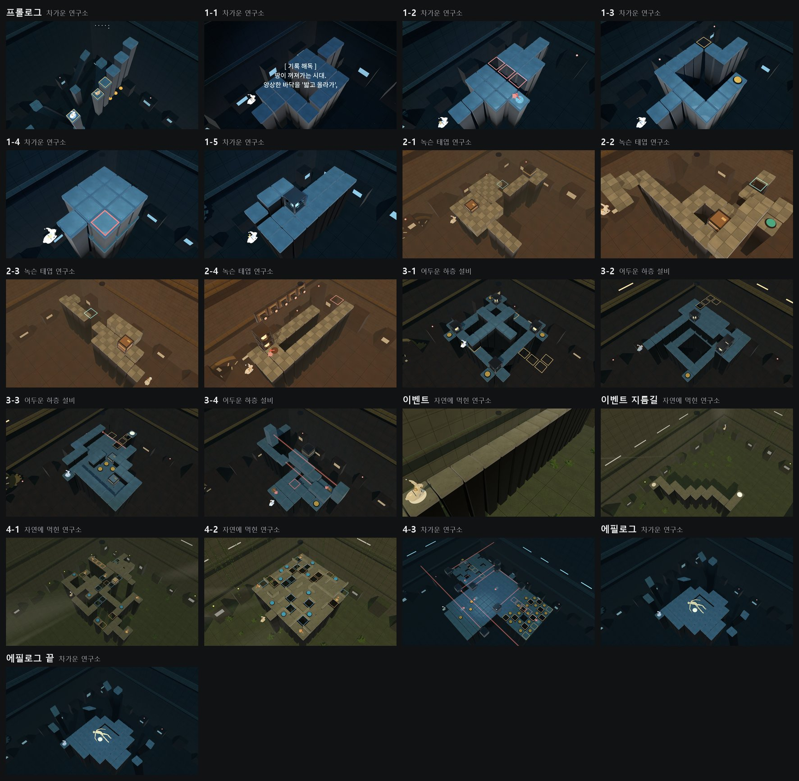
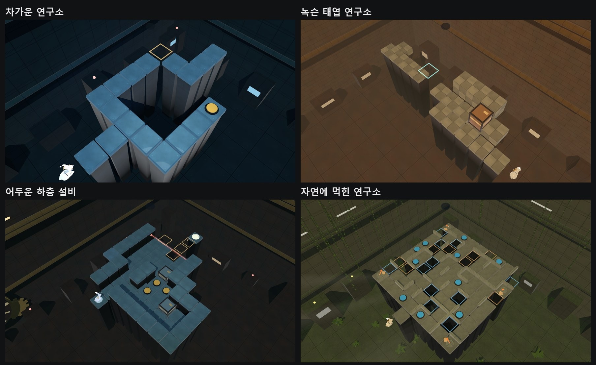
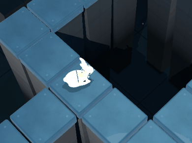
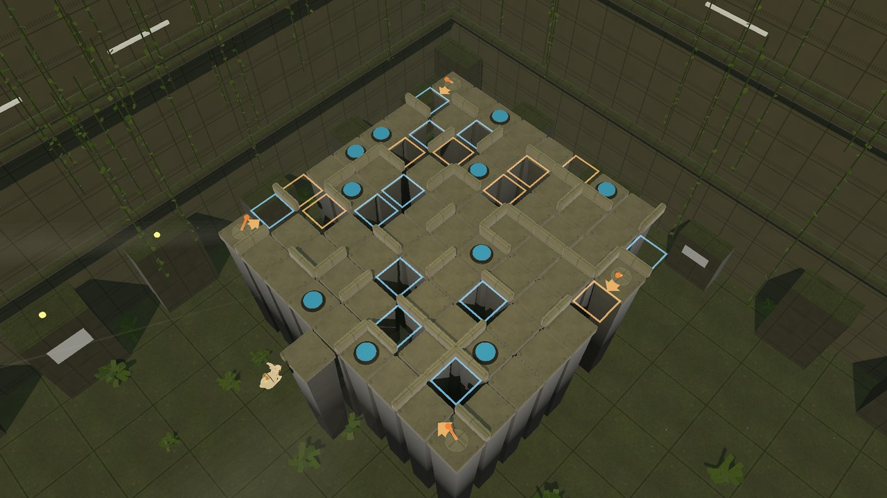
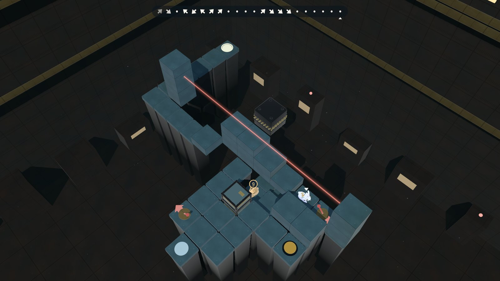
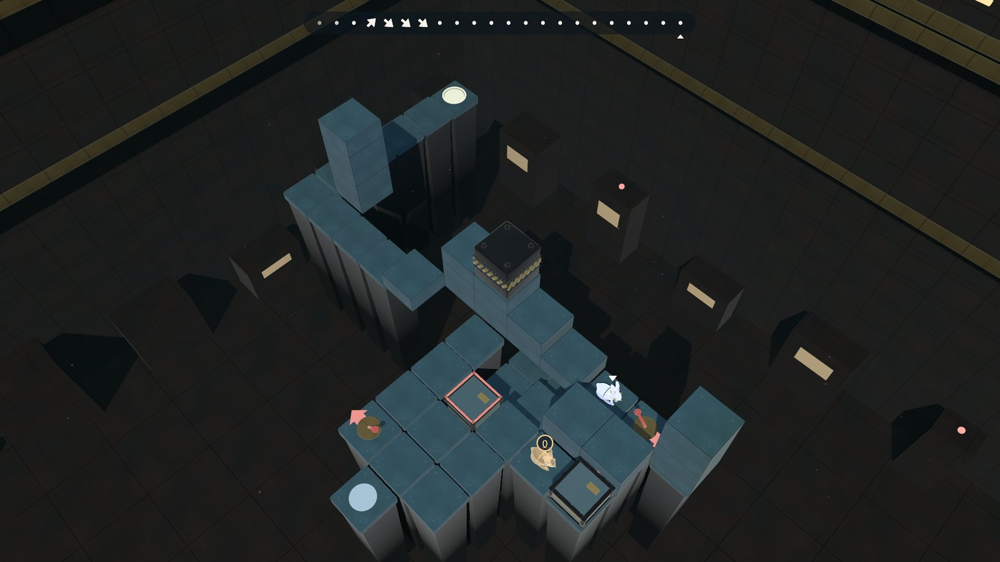
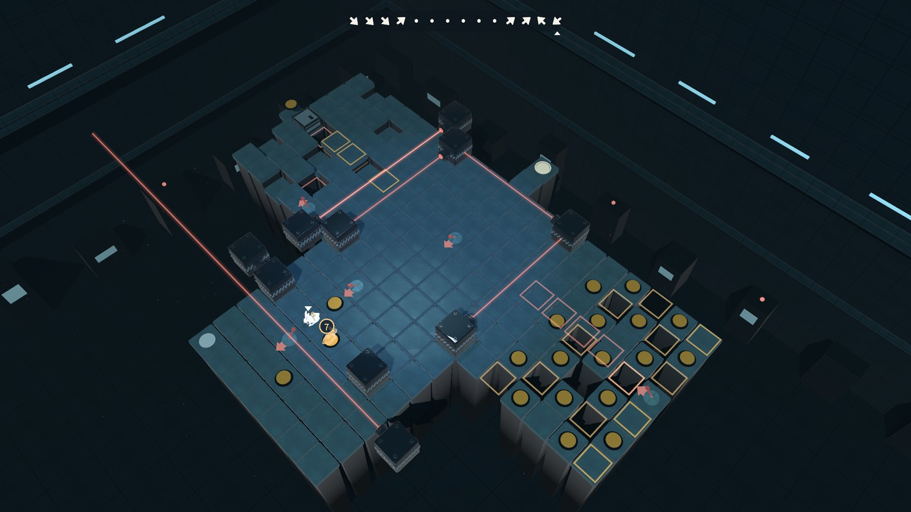
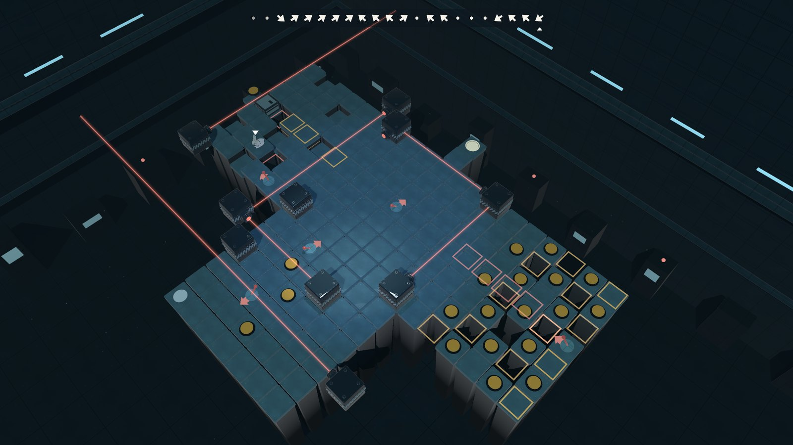
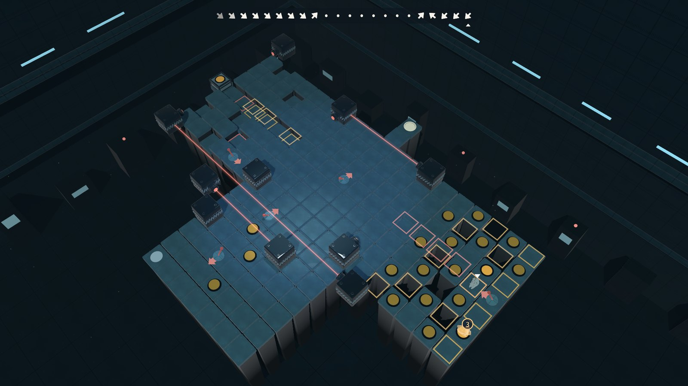

# Chronos

<p align="center">
  
</p>

**과거의 나와 협동하는 3D 턴제 퍼즐 게임.** 시간을 되감으면, 되감은 동안 했던 행동을 그대로 따라 하는 분신이 나타납니다. 분신이 발판을 밟고 레버를 당기고 상자를 미는 동안 본체는 다른 길을 갑니다.

2024년 가을 SWPP 12팀이 만든 원작을 Unity 6으로 옮기고, 버려진 연구소 콘셉트로 아트와 UI를 새로 만든 리메이크 브랜치입니다.

- 원작 WebGL 빌드: [플레이하기](https://2024fall-swpp.github.io/team-project-for-2024-fall-swpp-team-12/)
- 원작 매뉴얼: [manual.pdf](manual.pdf)

## 리메이크에서 바뀐 것

| | 원작 | 리메이크 |
|---|---|---|
| 엔진 | Unity 2021.3 | Unity 6 (6000.4.6f1) |
| 주인공 | 크리스털 토끼 | 등에 태엽 열쇠가 달린 둥근 기계 토끼 |
| 무대 | 하늘에 뜬 타일 | 버려진 연구소 안의 퍼즐 |
| 분위기 | 전 스테이지 동일 | 스토리에 따라 장마다 바뀜 |
| 장치 | 단색 도형 | 화물 상자, 코어 상자, 피스톤 블록, 레이저 발사기 |
| UI | 원작 HUD | 상단 타임라인 하나로 정리한 HUD |

### 장마다 바뀌는 연구소

스테이지마다 나오는 독백을 읽고 그 흐름에 맞춰 네 가지 분위기를 배치했습니다.

| 구간 | 분위기 | 이유 |
|---|---|---|
| 프롤로그, 1장 | 차가운 연구소 | 스승의 연구소에서 크로노스가 깨어나 남겨진 기록을 읽는 구간 |
| 2장 | 녹슨 태엽 연구소 | 루시, 뜨거운 빛줄기, 사람이 떠난 기계 작업실 |
| 3장 | 어두운 하층 설비 | "고개를 돌려 아래로", 갈림길과 숨겨진 통로 |
| 이벤트, 4-1, 4-2 | 자연에 먹힌 연구소 | 암막을 걷자 바람과 바깥이 밀려 들어옴 |
| 4-3, 에필로그 | 차가운 연구소 | 옛 시설을 그대로 발견하고 처음 자리로 돌아옴 |

<p align="center">
  
</p>

<p align="center">
  
  
</p>

## 조작

| 키 | 동작 |
|---|---|
| W A S D | 이동 (상자는 밀고, 한 칸 높이는 뛰어오름) |
| R | 한 턴 기다리기 |
| Space | 되감기 모드 켜고 끄기 (끄는 순간 분신이 생김) |
| Q / E | 되감기 모드에서 과거로 / 미래로 |
| Backspace | 한 턴 되돌리기 |
| Enter | 스테이지 다시 시작 |
| Esc | 일시 정지 |

## 실행하기

### 브라우저에서

[Chronos 소개 페이지](https://subir-sh.github.io/games/chronos/)의 플레이 링크로 itch.io에서 바로 할 수 있습니다.

빌드 파일은 저장소에 넣지 않습니다. 아래 명령으로 직접 만들 수 있습니다. 진행 상황은 원작과 다른 키에 저장되므로 원작 세이브를 건드리지 않습니다.

### 에디터에서

1. Unity 6000.4.6f1로 `Chronos` 폴더를 엽니다.
2. `Assets/Remake/Scenes/RemakeGame.unity`를 열고 실행합니다. 프롤로그부터 에필로그까지 리메이크 씬으로 이어집니다.
3. 원작은 `Assets/Scenes/LevelBaseScene.unity`에서 그대로 실행됩니다.

## 만드는 방법

리메이크 씬과 에셋은 모두 스크립트로 다시 만들 수 있습니다. 원작 씬과 프리팹은 수정하지 않고, 복사본에서 겉모습만 바꿉니다. 게임 판정에 쓰이는 원작 오브젝트와 콜라이더는 그대로 둡니다.

```bash
# 1) Blender 모델 (토끼, 타일 키트, 퍼즐 소품)
blender -b --factory-startup --python tools/blender/build_props.py -- <출력 폴더>

# 2) 리메이크 씬 19개, 머티리얼, 텍스처
Unity.exe -batchmode -quit -projectPath Chronos -executeMethod RemakeBuilder.BuildAll

# 3) Windows 실행 파일, 웹 빌드
Unity.exe -batchmode -quit -projectPath Chronos -executeMethod RemakeBuilder.BuildPlayer
Unity.exe -batchmode -quit -projectPath Chronos -buildTarget WebGL -executeMethod RemakeBuilder.BuildWebGL
```

| 경로 | 내용 |
|---|---|
| `Chronos/Assets/Editor/Remake/RemakeBuilder.cs` | 원작 씬을 복사해 리메이크 씬을 만드는 빌더 |
| `Chronos/Assets/Scripts/Remake/Visual/` | 팔레트, 연구소 배경, 장치 표시, 레이저 광선 |
| `Chronos/Assets/Scripts/Remake/UI/RemakeHUD.cs` | 리메이크 HUD |
| `Chronos/Assets/Scripts/Remake/Harness/` | 검증 하네스, 탐색기, 실행 파일 점검 |
| `tools/blender/` | 토끼와 소품 모델 스크립트 |
| `tools/solutions/` | 스테이지별 풀이 입력 |

## 검증

검증은 모두 소리를 끈 상태로 배경에서 돌립니다. 씬을 열기 전에 에디터 음소거, 오디오 리스너 볼륨 0, 일시 정지를 확인하고 로그에 남깁니다.

```bash
# 스테이지 하나를 풀이 입력대로 플레이
powershell tools/solve_runs.ps1 R-004-2

# 캠페인 전체를 이어서 진행하며 화면 캡처
powershell tools/run_harness.ps1 -Scene Assets/Remake/Scenes/RemakeGame.unity -Level R-Prologue -Index 0 -Campaign -Scenario script -ScriptFile tools/campaign.txt
```

### 스테이지 풀이 결과

하네스로 실제 입력을 넣어 끝까지 푼 결과입니다. 풀이는 `tools/solutions/`에 있고, 탐색이 필요한 스테이지는 하네스의 탐색기(`explore`)로 실제 이동 규칙을 확인하며 만들었습니다.

| 스테이지 | 결과 | 입력 | 되감기 |
|---|---|---|---|
| 프롤로그 | 연출 진행 확인 | | |
| 1-1 | 클리어 | 13 | 0 |
| 1-2 | 클리어 | 13 | 0 |
| 1-3 | 클리어 | 23 | 1 |
| 1-4 | 클리어 | 22 | 1 |
| 1-5 | 클리어 | 23 | 1 |
| 2-1 | 클리어 | 34 | 1 |
| 2-2 | 클리어 | 53 | 1 |
| 2-3 | 클리어 | 40 | 1 |
| 2-4 | 클리어 | 22 | 1 |
| 3-1 | 클리어 | 49 | 1 |
| 3-2 | 클리어 | 118 | 1 |
| 3-3 | 클리어 | 66 | 1 |
| 3-4 | 클리어 | 70 | 2 |
| 이벤트 | 클리어 | 32 | 0 |
| 4-1 | 클리어 | 204 | 6 |
| 4-2 | 클리어 | 293 | 10 |
| 4-3 | 클리어 | 185 | 4 |
| 에필로그 | 연출 진행 확인 | | |

모든 스테이지를 끝까지 풀 수 있습니다. 가장 어려운 두 스테이지의 핵심은 아래와 같습니다.

**3-4.** 얇은 상자 하나가 위층으로 오르는 디딤돌과 레이저를 끄는 발판 역할을 모두 해야 합니다. 디딤돌로 쓴 뒤 레버를 당기면 지하가 열리고, 구덩이에서 계단 밑 숨은 통로로 들어가 큰 상자를 밀면 얇은 상자가 그 위에 실린 채 아래층으로 돌아옵니다. 이 과정을 분신에게 맡기고 본체는 계단 위에서 기다렸다가 위쪽 발판을 밟습니다.

| 분신이 계단 밑에서 큰 상자를 미는 장면 | 얇은 상자가 발판에 올라가 레이저가 꺼진 장면 |
|---|---|
|  |  |

**4-3.** 시작 구역은 5번째와 7번째 줄을 오가며 쓸고 지나가는 레이저와, 3번째에서 9번째 줄까지 훑는 레이저에 갇혀 있습니다. 분신이 오른쪽 발판을 지키는 동안 본체가 레버를 당겨 양쪽에 블록 방패를 세우고, 그 사이로 중앙 홀에 올라갑니다. 중앙에서는 한 칸 낮은 구덩이로 움직이는 레이저를 피해 상자를 왼쪽 끝 발판에 올리고, 마지막 발판 미로는 분신 둘을 차례로 겹쳐 써야 레버에 닿습니다.

| 분신이 지키는 레이저 방패 | 구덩이에 숨어 레이저 피하기 | 분신 둘이 지키는 발판 미로 |
|---|---|---|
|  |  |  |

## 원작 팀

2024 Fall SWPP Team 12. 원작 저장소: [2024FALL-SWPP/team-project-for-2024-fall-swpp-team-12](https://github.com/2024FALL-SWPP/team-project-for-2024-fall-swpp-team-12)
